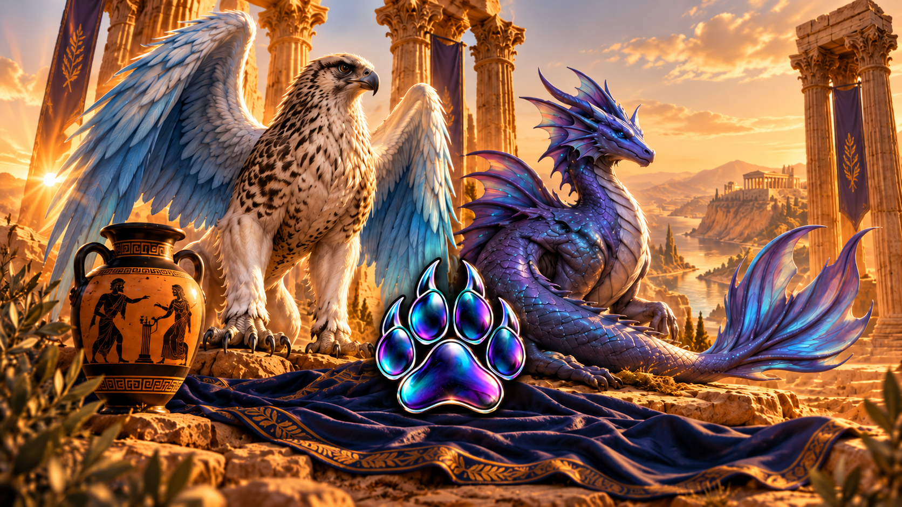

# Stridecraft: Gamifying advanced running

**Your effort becomes their power.**

Adopt a mythical creature at the start and embark on a mythical journey together. Stridecraft turns your real runs and training progression into a voyage across ancient Greece. Raise your strider, unlock skills and take down villains!

## Philosophy

- **Effortless.** Run and log in Strava as you already do. The app asks for no extra logging.
- **Your strider is its own creature.** Everything starts from the strider's own base stats. Only runs
  after you join count, so your past doesn't hand it free power.
- **Performance over presence.** Pace, PBs, volume, elevation and streaks make it stronger, not
  just "you ran today". Easy runs still help, and most of your runs should be easy.
- **Progress you keep.** Skills, quests and trophies are permanent. Your strider's stats reflect how
  you train together.
- **Win with preparation.** Your striders stats, unlocked skills and loadout acquired through training
  decide the outcome.
